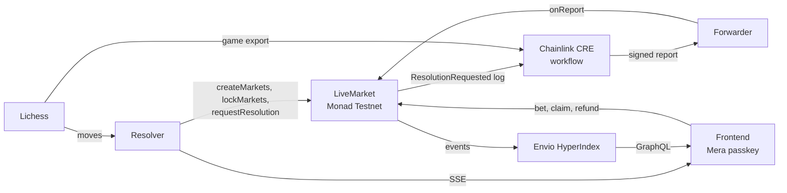

# MoveMarket

**Every move is a market.**

Live YES/NO prediction pools on chess games, settled by Chainlink CRE on Monad Testnet.

[Live demo](https://movemarket-chess.vercel.app) · [Project README](https://github.com/danustaif/movemarket-source#readme) · [Docs](#docs)

---

While a Lichess game is in progress, MoveMarket opens small pools about the next few plies, such as *"Any check in plies 25 to 28 (moves 13 to 14)?"*. You stake test USDC within a 15 second window. The contract closes the pool before the first ply in the range can be played. A resolver shows a provisional result within seconds, and a Chainlink CRE workflow writes the final result onchain. Accounts come from a passkey through Mera: no seed phrase, no wallet popup.

Built for **Monad Metropolis**, Track 03 (Social, Attention & Culture), for the Chainlink CRE, Monad Foundation (Mera UX), and Envio bounties.

## Try it

| | |
|---|---|
| App | [movemarket-chess.vercel.app](https://movemarket-chess.vercel.app) (replays start while someone is watching) |
| Resolver API | `https://api.43-133-151-182.sslip.io` (REST + SSE) |
| Indexer (Envio HyperIndex) | `https://indexer.43-133-151-182.sslip.io/v1/graphql` |
| Network | Monad Testnet, chain ID `10143` |

## Repositories

Clone all four side by side in one folder: `fe` and `backend` import `../source/shared`.

| Repo | What it holds |
|---|---|
| [movemarket-source](https://github.com/danustaif/movemarket-source) | Product and technical docs, the source of truth (`sot/`), the shared TypeScript package (`resolve()`, typed ABI, API and SSE contracts), design, and the demo video project |
| [movemarket-smart-contract](https://github.com/danustaif/movemarket-smart-contract) | Foundry: `LiveMarket` (parimutuel pools, CRE receiver), `MockUSDC`, `GatedForwarder`, tests with invariants, deploy and verify scripts |
| [movemarket-backend](https://github.com/danustaif/movemarket-backend) | Resolver service (Bun + Hono), Chainlink CRE workflow `resolver-workflow`, Envio indexer, Docker deploy |
| [movemarket-fe](https://github.com/danustaif/movemarket-fe) | Vite + React frontend with Mera passkey accounts and viem |

## Deployed on Monad Testnet

| Contract | Address |
|---|---|
| LiveMarket | [`0xA40F0D8f2e70bfd8F52B4d08089bD083cBdDB9a9`](https://testnet.monadscan.com/address/0xA40F0D8f2e70bfd8F52B4d08089bD083cBdDB9a9) |
| MockUSDC (tUSDC) | [`0x3670C61f0179dAEF70574C5f6cdC20b7d9986561`](https://testnet.monadscan.com/address/0x3670C61f0179dAEF70574C5f6cdC20b7d9986561) |
| GatedForwarder | [`0xc3b33f36C4fAc7bC37aC77a42E7EF1c08a81877C`](https://testnet.monadscan.com/address/0xc3b33f36C4fAc7bC37aC77a42E7EF1c08a81877C) |

All three are verified (exact match) on MonadVision and Monadscan. CRE evidence: a `cre workflow simulate --broadcast` report, tx [`0xb9ee…13c5`](https://testnet.monadscan.com/tx/0xb9ee7926662bce84c62e0907087a05ee75c8afdbc79c7b27c1f7fc4e56f013c5), whose consensus payload matches an independent recompute of the outcomes.

## How it works

1. **Spawn.** Every 4 plies the resolver opens a batch of questions about plies a few moves ahead.
2. **Stake.** One tap from a passkey account. Monad confirms in under a second, which is what makes a 15 second pool workable.
3. **Lock twice.** The contract rejects stakes after `lockTime`, and the resolver locks earlier the moment the ply before the range appears. Nobody can predict what they have already seen.
4. **Provisional result** within seconds over SSE, from the same `resolve()` function the CRE workflow runs.
5. **Final result** from the Chainlink CRE workflow: log trigger, contract read, Lichess fetch, consensus, signed report. Only this unlocks payouts. The contract owner can void a market but can never pick a winner.
6. **Claim or refund.** Positions and history come from Envio.

## Docs

Start with the [project README](https://github.com/danustaif/movemarket-source#readme), then:

| Document | Contents |
|---|---|
| [Source of truth](https://github.com/danustaif/movemarket-source/blob/main/docs/SOT.md) | Canonical values, design decisions D1 to D25, verification status |
| [Product requirements](https://github.com/danustaif/movemarket-source/blob/main/docs/PRD.md) | Problem, MVP scope, features, acceptance criteria |
| [Architecture](https://github.com/danustaif/movemarket-source/blob/main/docs/ARCHITECTURE.md) | Components, trust boundaries, env vars, deploy topology |
| [Sequences](https://github.com/danustaif/movemarket-source/blob/main/docs/SEQUENCES.md) | Sequence diagrams for every main flow |
| [Contracts](https://github.com/danustaif/movemarket-source/blob/main/docs/CONTRACTS.md) | `LiveMarket`, `MockUSDC`, `GatedForwarder` behaviour, invariants, test plan |
| [Resolution spec](https://github.com/danustaif/movemarket-source/blob/main/docs/RESOLUTION_SPEC.md) | Deterministic resolution rules and test vectors |
| [CRE workflow](https://github.com/danustaif/movemarket-source/blob/main/docs/CRE_WORKFLOW.md) | Chainlink CRE trigger, handler steps, consensus, simulation and deploy |
| [Resolver service](https://github.com/danustaif/movemarket-source/blob/main/docs/RESOLVER_SERVICE.md) | Modules, HTTP API, SSE events, faucet, replay |
| [Indexer](https://github.com/danustaif/movemarket-source/blob/main/docs/INDEXER.md) | Envio schema, handlers, queries |
| [Frontend](https://github.com/danustaif/movemarket-source/blob/main/docs/FRONTEND.md) | Routes, accounts, queries, mutations, Monad transaction rules |
| [User flow](https://github.com/danustaif/movemarket-source/blob/main/docs/USER_FLOW.md) | Screens, states, error handling |
| [Design](https://github.com/danustaif/movemarket-source/blob/main/DESIGN.md) | Visual tokens and components |
| [Roadmap](https://github.com/danustaif/movemarket-source/blob/main/docs/ROADMAP.md) | Daily plan and status |

Internal documents are written in Indonesian; the project README and this page are in English.

## Honest limits

- CRE runs through `cre workflow simulate --broadcast` until Chainlink grants deploy access. Meanwhile the hosted resolver runs the same workflow steps in a mock mode, and only its wallet may call the `GatedForwarder`.
- Testnet only. tUSDC has no value.
- Replays use finished public games and are labelled REPLAY in the app.
